# Arquitetura do Projeto (`arquitetura.md`)

## 1. Visão Geral em Quatro Blocos

O projeto está dividido em quatro blocos funcionais independentes:

```mermaid
flowchart TD
    subgraph B1["Bloco 1: Inspeção de Metadados (Parte 1: Q1, Q3)"]
        Q1["01_listar_indices.sql"]
        Q3["02_listar_foreign_keys.sql"]
    end

    subgraph B2["Bloco 2: Administração e DDL Dinâmico (Parte 1: Q2, Q4)"]
        Q2["01_remover_indices.sql"]
        Q4["01_gerar_create_table.sql"]
    end

    subgraph B3["Bloco 3: Motor Configurável de Estados / DTE (Parte 1: Q5)"]
        M1["01_tabelas_configuracao.sql (bd2_meta)"]
        M2["02_funcao_validacao.sql (fn_validar_transicao_estado)"]
        M3["03_procedures_registro.sql (registrar/remover_binding)"]
        M4["04_demo.sql (invoice.status + bd2_demo.pedido_demo)"]
        M1 --> M2 --> M3 --> M4
    end

    subgraph B4["Bloco 4: Integridade Semântica e Permissões (Parte 2: Q1–Q4)"]
        S0["00_roles_e_permissoes.sql (bd2_owner, bd2_app)"]
        S1["01_trigger_hierarquia_employee.sql (R-TRG-01)"]
        S2["02_integridade_invoice_total.sql (R-TRG-02)"]
        S3["03_procedure_criar_fatura.sql (R-SP-01)"]
        S0 --> S2 --> S3
    end
```

- **Isolamento de domínio:** Os Blocos 1, 2 e 3 (`bd2_meta`) são 100% genéricos e não conhecem nomes de tabelas do Chinook. Apenas o cenário de demonstração (`04_demo.sql`) e o Bloco 4 operam sobre objetos específicos do Chinook.

---

## 2. Organização de Schemas no Banco `chinook_serial`

| Schema | Finalidade | Objetos Principais |
|---|---|---|
| `public` | Esquema original do Chinook v1.4.5 (`SerialPKs`) + regras da Parte 2 | 11 tabelas do Chinook, triggers `R-TRG-01` e `R-TRG-02`, procedure `criar_fatura_com_itens` (`R-SP-01`) |
| `bd2_meta` | Catálogo de configuração do motor de máquina de estados (DTE) e utilitários genéricos da Parte 1 | `state_machine`, `state_definition`, `state_transition`, `state_binding`, funções e procedures genéricas |
| `bd2_demo` | Objetos auxiliares de demonstração e testes que não devem poluir `public` | `pedido_demo` (segunda tabela do DTE), `chinook_clone` (schema de teste para o gerador de DDL da Q4) |

---

## 3. Ordem de Execução dos Scripts

A execução automatizada (`run_all.sh` / `run_all.ps1`) segue estritamente a ordem abaixo devido às dependências entre objetos:

1. `sql/00_ambiente/Chinook_PostgreSql_SerialPKs.sql` — Recria o banco `chinook_serial` e popula os dados originais.
2. `sql/00_ambiente/00_verificar_ambiente.sql` — Cria os schemas `bd2_meta` e `bd2_demo`, valida as 11 tabelas e audita `invoice.total`.
3. `sql/01_catalogos/01_listar_indices.sql` e `02_listar_foreign_keys.sql` — Views/funções de inspeção do catálogo (P1-Q1 e P1-Q3).
4. `sql/02_administracao/01_remover_indices.sql` — Procedure de remoção segura de índices (P1-Q2).
5. `sql/03_ddl_dinamico/01_gerar_create_table.sql` — Função geradora de DDL `CREATE TABLE` + PK + FK (P1-Q4).
6. `sql/04_maquina_estados/01..04_*.sql` — Tabelas de metadados, função genérica de trigger, procedures de binding e demonstração (P1-Q5).
7. `sql/05_regras_semanticas/00_roles_e_permissoes.sql` — Criação idempotente dos papéis `bd2_owner` e `bd2_app`.
8. `sql/05_regras_semanticas/01_trigger_hierarquia_employee.sql` — Trigger `R-TRG-01` (P2-Q2).
9. `sql/05_regras_semanticas/02_integridade_invoice_total.sql` — Triggers `R-TRG-02` (P2-Q4, **pré-requisito para R-SP-01**).
10. `sql/05_regras_semanticas/03_procedure_criar_fatura.sql` — Procedure `R-SP-01` e grants de execução (P2-Q3).
11. `sql/06_testes/*.sql` e `06_concorrencia.sh` — Bateria de testes automatizados positivos, negativos e de concorrência.
